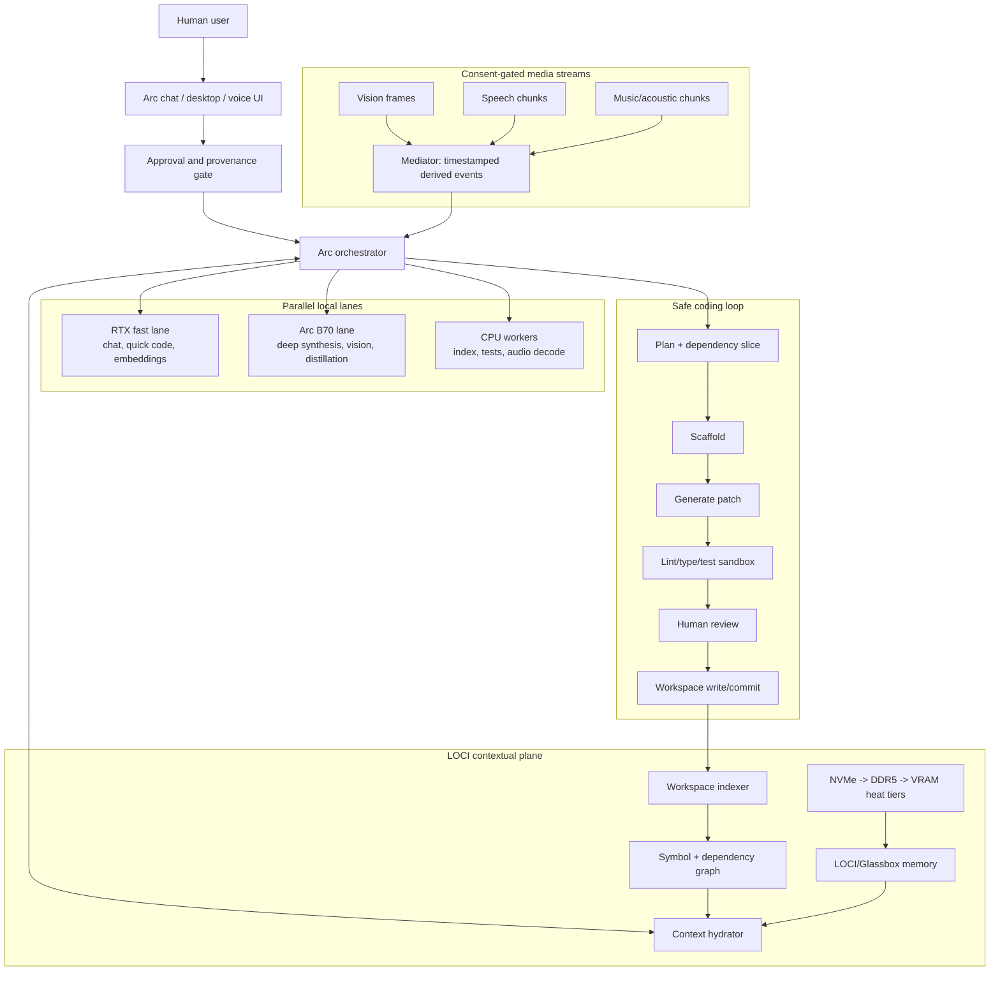

# Arc vision, music, coding, and Loci blueprint

```yaml
version: v0001
timestamp_utc: 20261119T172044Z
host: arko-loci-workstation
agent: gemini
active_outbox: /home/arko-sanyal/.local/share/loci-outbox
staging_dir: /home/arko-sanyal/loci-staging
hostinger_target: vps-billo (187.127.121.247)
notes: Versioned session checkpoint; append new versioned files rather than overwriting history.
```

## Executive decision

Arc does **not** need 30,000 TB of VRAM to code across a large operating
system or repository. The correct design is a dependency-aware,
retrieval-driven runtime:

1. Index the whole workspace as compact symbols, imports, tests, ownership,
   hashes, and dependency edges.
2. Keep cold knowledge in LOCI/NVMe and warm summaries in host memory.
3. Hydrate only the task-relevant files, symbols, tests, and immediate
   dependencies into the active context.
4. Scaffold first, execute validation second, and write/commit only after an
   approval gate.
5. Keep vision, speech, and music as independent consent-gated streams whose
   outputs are compact events rather than permanent raw media.

The full codebase is a map. The model receives a working set.

## Advice from Arc

Arc's current local response recommends the following:

- **Contextual sparsity:** never load what the task does not query; use LOCI
  retrieval plus a dependency graph to hydrate the active working set.
- **Decoupled streams:** vision, audio, and music should be independent
  asynchronous pipelines feeding a mediator with derived events.
- **Asymmetric compute:** keep the responsive reasoning lane separate from
  vision, embedding, indexing, and validation work.
- **Staged execution:** speculative generation, automated validation, then
  human-approved write-back.
- **Distillation:** use a deeper teacher to label and summarize difficult
  code interactions, then train smaller probes for routine local tasks.

These are design recommendations, not claims that every proposed component is
already production-ready.

## Current baseline

Verified at blueprint time:

| Capability | Current state |
|---|---|
| Arc chat | Local REST/WebSocket chat on `127.0.0.1:7860` |
| LOCI/Glassbox | Runtime memory bridge and session continuity active |
| RTX lane | Ready; 16 GB class GPU; fast local models installed |
| Arc B70 lane | Ready; 32 GB class GPU; second lane alive |
| GPU orchestration | Heartbeat lane mask `3`; both workers alive |
| Vision | Consent-gated capture and local Qwen-VL analysis path |
| Speech | Consent-gated short-chunk transcription path |
| Music | Consent-gated local acoustic analysis and beat cues |
| Coding tools | Bounded workspace read/write/check/list, scratchpad, MCP |
| Knowledge distillation | Heat-filtered LoRA/KD research implementation; not yet the default training service |
| Camera hardware | Not currently visible to the OS in the latest inventory |
| Raw capture | Must remain user-started and opt-in |

The status label `local-consent-gated-acoustic-analysis` means music features
are wired as acoustic/beat analysis. It does not claim song identification,
speaker identity, or a finished semantic-intervention system.

## Target topology



## Dependency-aware context model

### Index records

Each indexed unit should have:

```json
{
  "node_id": "sha256:path:symbol:start:end",
  "path": "src/module.py",
  "symbol": "Module.method",
  "kind": "function",
  "span": {"start": 10, "end": 42},
  "imports": ["src/types.py"],
  "calls": ["src/helper.py:helper"],
  "tests": ["tests/test_module.py::test_method"],
  "hash": "sha256...",
  "heat": 0.62,
  "provenance": "workspace-index",
  "tier": "ddr5"
}
```

The index is not a second source of truth. Source files remain authoritative;
the index is invalidated by file hashes and rebuilt incrementally.

### Retrieval and hydration

For a coding request:

1. Parse the request into intent, target symbols, constraints, and expected
   validation.
2. Search LOCI semantic memory and the symbol graph.
3. Retrieve the target file plus immediate imports, callers, interfaces,
   fixtures, and tests.
4. Expand one dependency hop by default; expand more only when a compiler,
   test, or graph edge proves it is needed.
5. Apply a token/VRAM budget and preserve provenance for every hydrated block.
6. Ask the model for a plan before a patch when the task crosses subsystem
   boundaries.

This makes context size proportional to the task, not the repository.

## Dual-GPU policy

The current runtime already reports both lanes alive. The target policy is:

| Lane | Preferred work | Protection |
|---|---|---|
| RTX 5060 Ti | Fast chat turns, code navigation, embeddings, small probes | Keep responsive; cap long jobs |
| Intel Arc B70 | Deep synthesis, vision batches, distillation teacher or evaluator | Sovereignty/priority lane; avoid starvation |
| CPU/DDR5 | Indexing, parsing, media decode, tests, orchestration | Backpressure and bounded queues |

The roles are policy defaults, not hardcoded model placement. A benchmark must
confirm latency, memory pressure, and cross-lane interference before changing
model assignments.

Do not treat aggregate VRAM as one transparent 48 GB pool. The cross-GPU path
is slower than on-card memory, and the tier manager is a placement ledger plus
offload mechanism, not magic unified memory.

## Vision, speech, and music

Each stream has its own queue and timestamp domain:

```text
camera frame -> vision worker  ─┐
audio chunk  -> speech worker  ─┼─> mediator -> Arc context event
audio chunk  -> music worker  ─┘
```

Required event fields:

- `stream_id`, `pts_ms`, `source`, `consent_scope`;
- derived features and confidence;
- provenance and model version;
- expiry/retention policy;
- optional link to a user-approved transcript or scene summary.

Rules:

- Never infer speaker identity from pitch, reverb, or direction alone.
- Treat “Hey Arc” as an addressing cue, not proof of identity.
- Reverb/distance/direction are uncertain acoustic measurements and need
  calibration before they can affect interruption policy.
- Speech and music may be analyzed from the same chunk, but the mediator must
  avoid allowing background music to become a false command.
- Raw frames/audio remain transient unless the user explicitly starts a
  consented recording and chooses a private retention destination.

## Coding and code-generation loop

```text
REQUEST
  -> classify task and risk
  -> dependency slice
  -> plan / assumptions / affected files
  -> scaffold or patch in staging
  -> run formatter, type check, tests, smoke checks
  -> show diff and evidence
  -> human approval for side effects
  -> write/commit
  -> re-index changed symbols
```

Arc's current bounded workspace tools already provide the basic read/write/
check surface. The missing production layer is a durable task graph with
plans, dependency evidence, test results, approval state, and cancellation.

### Tool classes

| Class | Examples | Default gate |
|---|---|---|
| Read | workspace list/read, memory search, status | Allowed in scoped workspace |
| Generate | scratchpad, plan, patch proposal | No external side effect |
| Validate | syntax, tests, type checks, dry-run sync | Allowed in sandbox |
| Write | workspace write, generated artifact | Human approval when production-facing |
| External | DNS, Hostinger, Shopify, email, payments | Explicit one-shot approval |

## Knowledge distillation from the LOCI corpus

The existing heat-filtered KD/LoRA trainer is a research component. The
production pipeline should be:

1. Select only provenance-valid, non-secret LOCI nodes.
2. Exclude credentials, intimate personal data, raw media, and unlicensed
   material.
3. Deduplicate by content hash and group by task/domain.
4. Use a deeper teacher to produce:
   - answer traces;
   - dependency explanations;
   - test plans;
   - failure/correction pairs;
   - tool-use decisions.
5. Attach source node IDs, heat, confidence, and teacher version.
6. Train a small adapter/probe offline with held-out repository tasks.
7. Evaluate retrieval faithfulness, compile/test success, refusal behavior,
   and regression against the base model.
8. Promote an adapter only after a human-reviewed report.

Distillation compresses recurring behavior; it does not replace retrieval.
Fresh or rare code should still be hydrated from LOCI and the workspace.

## Dependency roadmap

```text
R0  Health + consent contract
 |\
 | +--> R1  Incremental symbol/dependency index
 |       |
 |       +--> R2  LOCI hydration and provenance packets
 |               |
 |               +--> R3  Coding task graph and staged executor
 |                       |
 |                       +--> R4  Dual-lane scheduling/backpressure
 |
 +--> M1  Audio/vision event schemas
         |
         +--> M2  Speech/music mediator
                 |
                 +--> M3  Addressing/interruption policy

R2 + R4 --> D1  Teacher dataset builder
D1       --> D2  Heat-filtered KD/LoRA evaluation
D2       --> D3  Optional small local coding probe

R3 + M2 + D3 --> R5  Unified Arc coding/voice workbench
```

## Phases and acceptance gates

### Phase 0 — baseline and safety

- Keep `arc-interface.service`, `arc-monitor.service`, and both inference
  lanes healthy.
- Keep media capture opt-in.
- Add status fields for stream readiness, queue depth, and consent state.
- Acceptance: no raw media is persisted without an explicit session.

### Phase 1 — dependency index

- Build an incremental parser/indexer.
- Store symbol/import/test edges with hashes.
- Add graph-aware retrieval tests.
- Acceptance: a changed file invalidates only affected nodes.

### Phase 2 — coding workbench

- Add durable task IDs, plans, dependency slices, patches, checks, and
  approval state.
- Keep writes bounded to the selected workspace.
- Acceptance: Arc can implement a small change from plan through passing test
  without loading unrelated files.

### Phase 3 — media mediator

- Run vision, speech, and music workers independently.
- Add timestamps, confidence, event expiry, and consent state.
- Acceptance: background music does not trigger a code or external action.

### Phase 4 — distillation

- Build a sanitized LOCI corpus and teacher labels.
- Train/evaluate a small probe offline.
- Acceptance: held-out coding tasks show improvement without provenance or
  secret leakage.

### Phase 5 — external systems

- Add Hostinger/Shopify/Loyverse adapters only in dry-run mode.
- Use staging and explicit human approval for every production write.
- Acceptance: backup, restore, rollback, and audit checks all pass.

## Versioned checkpoint and continuity

The supplied checkpoint belongs in the append-only outbox and should not
overwrite earlier state:

```text
active_outbox=/home/arko-sanyal/.local/share/loci-outbox
staging_dir=/home/arko-sanyal/loci-staging
hostinger_target=vps-billo (187.127.121.247)
```

LociSync should synchronize:

- versioned manifests;
- hashes;
- task/approval state;
- redacted derived stream events;
- encrypted, scoped continuity notes.

It should not blindly synchronize:

- the entire source tree;
- credentials or browser profiles;
- raw camera/audio/motorbike videos;
- private databases or customer records;
- arbitrary working directories.

## Immediate next actions

1. Add the dependency indexer and symbol graph as a read-only service.
2. Add a durable coding task record and staged patch executor.
3. Expose media queue/consent status in Arc health.
4. Add focused tests for graph hydration, provenance, and tool approvals.
5. Keep the current dual-GPU lanes; benchmark role assignment before changing
   model placement.
6. Build a sanitized LOCI distillation dataset and evaluate it before training
   an adapter.

