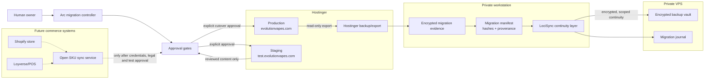

# Hostinger migration schematic

## Scope

This schematic covers the controlled migration of `evolutionvapes.com` from
the current Hostinger WordPress installation toward a reviewed commerce
storefront. It does **not** authorize a production cutover, a domain change,
an external payment integration, or publication of vape-product content.

The current verified state is:

- Production domain: `evolutionvapes.com`
- Production site: Hostinger WordPress, currently showing starter/Coming Soon
  content
- Staging site: `test.evolutionvapes.com`
- Staging root:
  `/home/u770859881/domains/evolutionvapes.com/public_html/test`
- A Hostinger website/database backup exists and has passed archive checks.
- The backup was restored in an isolated environment; production was not
  modified.
- No Shopify store or SKU synchronization is connected.

## System topology



## State machine

```text
DISCOVERED
   |
   v
BACKED_UP -- backup hash/restore check fails --> BLOCKED
   |
   v
STAGED -- content, legal, payment or data check fails --> BLOCKED
   |
   v
OWNER_REVIEW
   |
   +-- rejected --> STAGED
   |
   v
CUTOVER_READY
   |
   +-- maintenance window not confirmed --> BLOCKED
   |
   v
CUTOVER_APPROVED
   |
   v
LIVE_MONITORED
   |
   +-- health check fails --> ROLLBACK
   |
   v
RECOVERED
```

## Responsibility boundaries

| Area | Arc may do | Human must approve |
|---|---|---|
| Discovery | Read account/site metadata and produce a manifest | Nothing |
| Backup | Start or verify a backup using owner-scoped credentials | Any deletion or overwrite |
| Staging | Create files, test imports, run checks in staging | Publication of business content |
| Commerce | Generate an adapter design and test fixtures | Store creation, payment, catalog sync |
| DNS/domain | Prepare a change plan and expected records | Every DNS or domain cutover |
| Production | Read health checks and compare hashes | Any write, migration, or rollback |
| Media/private data | Hash, encrypt, and keep scoped | Uploading or sharing raw media |

## Non-negotiable invariants

1. Production is read-only until `CUTOVER_APPROVED`.
2. Every migration artifact has a SHA-256 hash and source/provenance record.
3. Backups are retained before any destructive operation.
4. Credentials stay in owner-only local configuration; never in this document,
   chat, Git, public web content, or broad agent context.
5. LociSync may carry encrypted, scoped continuity records. It is not a
   replacement for a Hostinger backup, database dump, or raw-media archive.
6. Raw customer, personal, audio, video, and payment data is not copied into
   public repositories or broad agent memory.
7. Shopify, payment, age-verification, tobacco/vape publication, and
   Bangladesh-law questions require separate review before launch.

