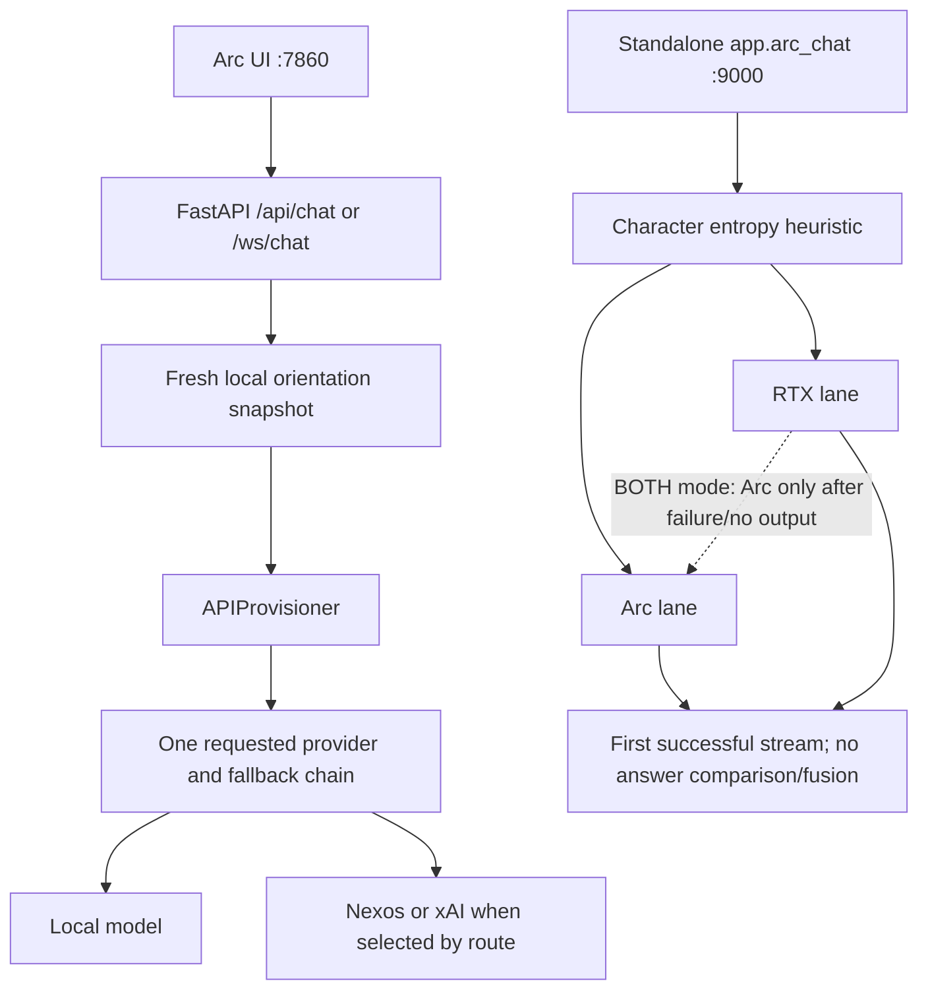
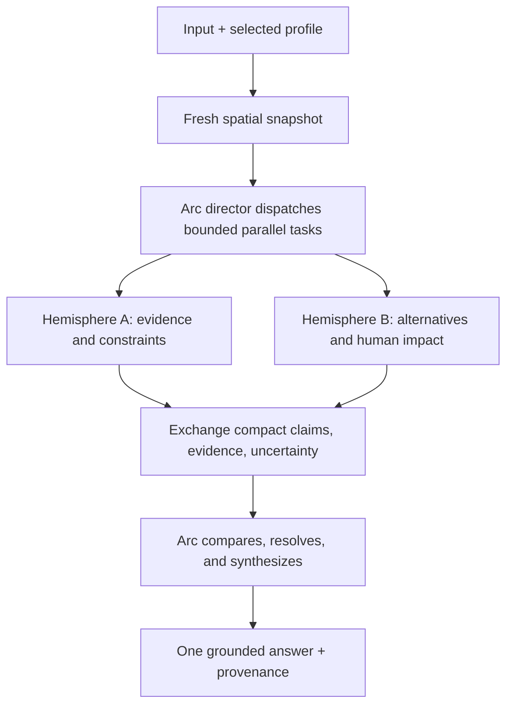

# Arc inference director map

Status: code inspection of the current checkout. The desired dual-hemisphere
director is a target design; it is not yet implemented as parallel inference.

## Current request paths

The two applications are distinct. The primary UI sends to `APIProvisioner`;
it does not invoke the semantic router or two inference paths. The standalone
`app.arc_chat` router uses `Lane.BOTH` for moderate/complex requests, but streams
RTX first and calls Arc only if RTX fails or emits no tokens. A normal RTX answer
ends the request without Arc grounding it. Therefore the current code does not
provide the high-speed, reciprocal grounding between hemispheres described in
the design.

The declared GPU handoff and heartbeat use `/dev/shm`, which is host-local
shared memory. They can coordinate processes on one machine; they do not form a
transport between remote machines. The inspected inference paths contain no
peer discovery, remote worker registry, request/response bus, or bounded
cross-host evidence exchange. Thus “over distance” is not currently wired by
this repository.

## Most likely lapse behind the imbalance

The primary code-level cause is a missing arbitration/fusion stage. `BOTH` is a
fallback label, not parallel execution. Neither lane receives the other lane's
evidence, confidence, or objections, and there is no Arc-owned synthesis step.
Separately, the current route score estimates character entropy; it does not
measure truth, emotional need, empathy, or whether an answer is practical. Those
signals cannot reliably distinguish a precise answer from a socially tone-deaf
one, or useful creativity from irrelevant improvisation.

The primary UI path can also select a single provider directly. Its `LOCAL`
chain is local-only; no second local hemisphere is invoked by that path.

The 7.9 GB/s figure in the repository is an input assumption in the synthetic
ring-sizing script, not a measured inter-GPU or network rate. That script
measures CPU-side synthetic packet encoding and estimates buffer capacity; it
does not transfer packets between GPUs or hosts.

## Target director flow

This is a proposed wiring map, not evidence of active workers or measured
performance. “Emotional intelligence” should be evaluated as observable
criteria (recognize stated emotion, avoid unsupported diagnosis, acknowledge
impact, keep advice useful, and preserve uncertainty), rather than treated as a
property guaranteed by adding another model.

## Expected effect of speed, parallel paths, and bandwidth

- A faster model lowers its own generation time; it does not automatically
  increase context exchange, agreement, or answer quality.
- True parallel execution changes end-to-end time from roughly a serial sum to
  `max(path A, path B) + exchange + Arc synthesis`, assuming enough independent
  compute. The current `BOTH` path is sequential fallback, so it has no such
  benefit.
- More paths can improve coverage if each has a distinct, bounded role. They
  also increase GPU contention, duplicated context traffic, disagreement, and
  synthesis load. Unbounded fan-out can make answers slower and less coherent.
- Communication time is at least `payload_bytes / effective_bandwidth`, plus
  round-trip latency, queueing, serialization, and fusion time. Faster links
  help only the communication portion.
- Keep model weights resident beside each inference worker. Send a compact
  request, selected evidence, short claims, confidence, and unresolved
  questions. Moving full model weights or large KV/cache state between machines
  for each request would usually dominate the savings.

## Orientation and command-center scope

`core.orientation` takes a fresh read-only snapshot before calls through both
inference entry points. The local command center polls detailed interface,
route, CPU, memory, and GPU readings. The model prompt receives a filtered
summary: exact host name, local IP addresses, and gateway addresses stay local.
This is machine context, not human spatial awareness or external network
discovery. Interaction profiles are selected labels and do not authenticate a
person. Linked projects are references, not authorship assertions.

## Validation boundaries

Source inspection establishes the control flow above. It does not establish
which models are loaded on the real workstation, GPU link bandwidth, worker
placement, or any runtime speed. Those require measurements on the target host
with per-path latency, queue time, tokens/s, bytes exchanged, utilization, and
quality ratings recorded separately.
